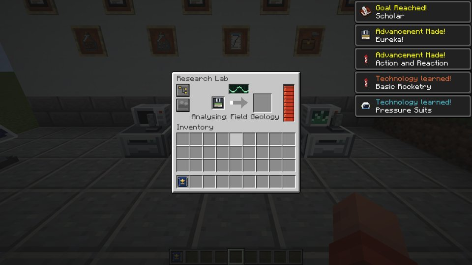
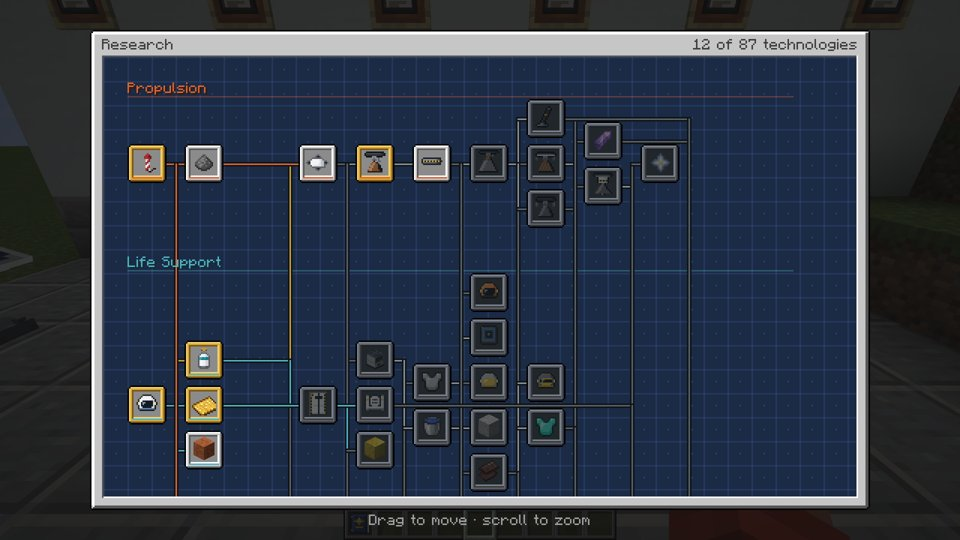
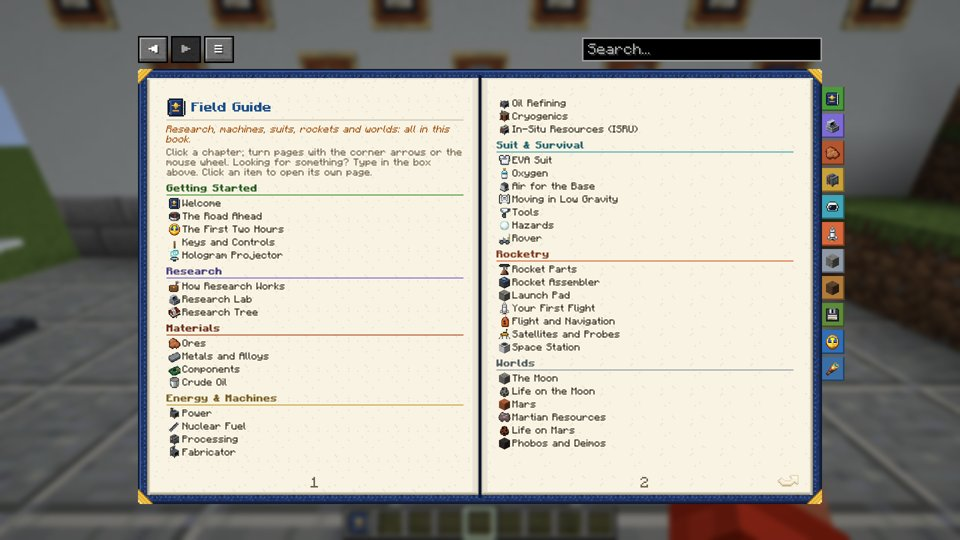
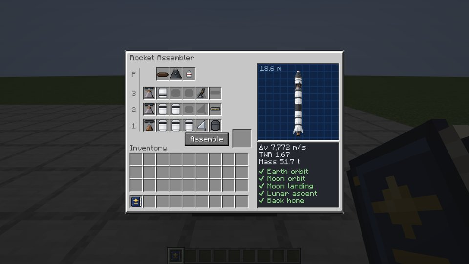
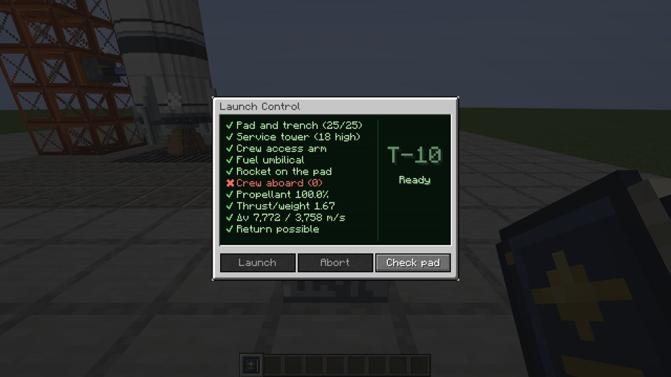
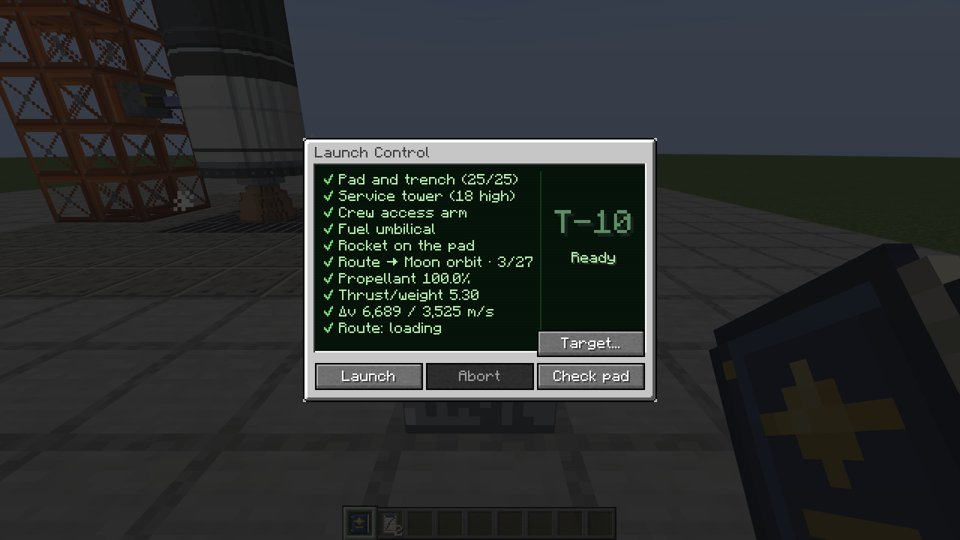
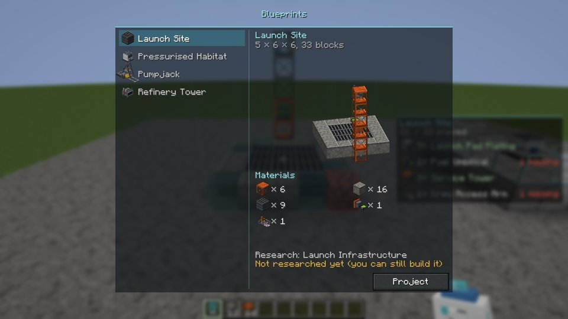
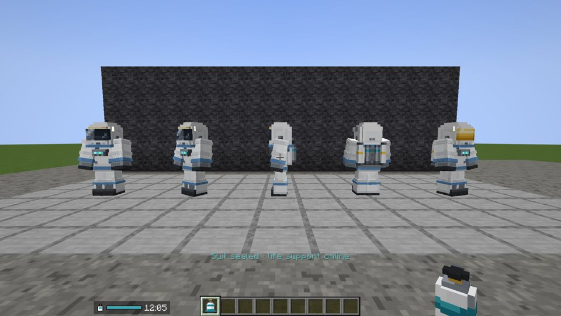
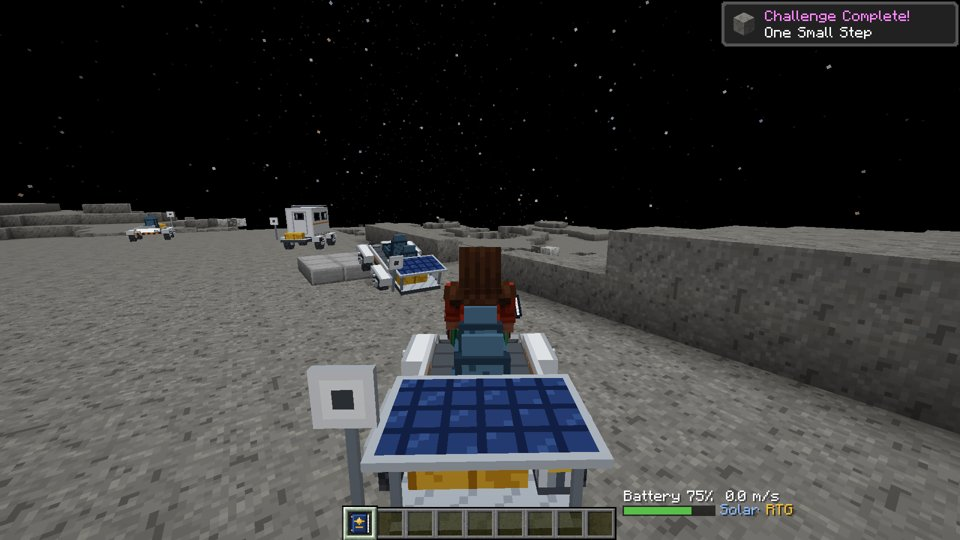

# Arayüz sadelik denetimi (2026-11-07)

Bu belge yalnızca rapordur; içindeki öneriler ekranların sahiplerine dağıtılmak içindir. Kareler
`docs/screenshots/gui_audit/` altında (vanilla, 1920×1080'den küçültülmüş, `runShowcase` ile çekildi).

Ölçüt, sanayi makinelerine uygulanan düzendir (`MachineLayout.tidy()` + `MachineScreen`):

- **Tutarlı yerleşim:** her ekranda aynı şey aynı yerde. Enerji en solda, ilerleme ortada, girdiler solda, çıktılar sağda.
- **Az yazı:** başlıktan başka kalıcı yazı yok. "Inventory" gibi açıklama başlıkları kalkar; uzun ad kısa adla gösterilir.
- **Sayılar ipucunda:** ekranda çubuk, simge ya da ✓/✗ görünür. Sayının kendisi fareyle üzerine gelince çıkar.
- **Sorunlar işaretle gösterilir:** durum cümlesi yerine küçük kırmızı bir işaret konur, açıklaması fareyle görünür.

## Araştırma (research)

### Araştırma laboratuvarı — `04_lab_gui.jpg`

1. "Inventory" başlığını kaldır. "Analysing: Field Geology" satırını ilerleme okunun ipucuna taşı; satır şu an slotların altında sıkışık duruyor.
2. Enerji çubuğunu sağdan en sola al; makinelerle aynı yer olsun. Girdi → ok → çıktı tek orta çizgide dursun.
3. Sol üstteki iki simge düğmeyi başlık satırının sağına taşı (makinelerde redstone düğmesinin durduğu yer). Osiloskop ekranı süs olarak kalabilir, ama okun üstünde değil yanında.
4. Laboratuvar açıkken art arda 5 bildirim ekranın sağını kaplıyor. Aynı anda gelen teknoloji/başarım bildirimleri tek bildirimde birleşsin ("3 teknoloji öğrenildi"), ayrıntı fareyle görünsün.

### Araştırma ağacı — `05_research_tree.jpg`

1. Sağ üstteki "12 of 87 technologies" yazısı yerine ince bir ilerleme çubuğu koy; sayı ipucunda.
2. Bağlantı çizgileri çok sayıda dikey hat oluşturuyor. Yalnızca fareyle seçili düğümün ön koşul ve sonrakilerini vurgula, diğer çizgileri soluklaştır.
3. Hotbar üstündeki "Drag to move · scroll to zoom" ipucu ilk açılışta bir kez görünsün, sonra kaybolsun ya da bir "?" düğmesinin ipucuna gitsin.
4. Durumlar (öğrenildi / araştırılabilir / kilitli) yalnız kenarlık rengiyle ayrılıyor. Kilitlilere küçük bir kilit simgesi ekle; maliyet ve gereken veri ipucunda kalsın.

### Saha rehberi — `07_guide_contents.jpg`

1. İçindekiler iki sayfada 40'tan fazla satır. Yalnız bölüm başlıklarını göster, tıklayınca altı açılsın. Sağdaki renkli sekmeler zaten bölümlere gidiyor; iki gezinme yolu birbirini tekrarlıyor.
2. Giriş paragrafını ("Click a chapter; turn pages…") kaldır ya da bir kez göster.
3. Üstteki ok/menü düğmeleri ve arama kutusu kitabın dışında, kitapla hizasız duruyor. Kitabın üst kenarına hizalı tek bir şerit yap.

## Roketçilik (rocketry)

### Roket montaj ekranı — `05_assembler_gui.jpg`

1. "Inventory" başlığını kaldır. Satır etiketleri "P/3/2/1" anlaşılmıyor ("P" ne?): küçük simgeler kullan, anlamı ipucunda.
2. Sağ paneldeki Δv / TWR / kütle sayıları ve 5 satırlık görev listesi: panelde yalnız ✓/✗ simgeleri ya da en uzak ulaşılan hedef kalsın ("Ay'a gidip dönebilir ✓"). Sayılar fareyle görünsün.
3. "Assemble" düğmesi ile çıktı slotunu makinelerdeki gibi tek çizgide yap: parçalar → ok/düğme → çıktı.
4. Roket önizlemesindeki "18.6 m" etiketi önizlemenin ipucuna gidebilir.

### Fırlatma konsolu (insanlı, insansız, kargo rotası) — `06_console_gui.jpg`, `33_uncrewed_console.jpg`, `42_cargo_route_console.jpg`

1. Her zaman 10 satırlık kontrol listesi görünüyor. Yalnız eksik olanları (✗) göster; hepsi tamamsa tek bir "Hazır" satırı yeter. Tam liste "Check pad" ile ya da ipucunda açılsın.
2. Satırlardaki sayılar (25/25, 18 high, 100.0%, 1.67, 7,772 / 3,758 m/s) ipucuna gitsin; satırda yalnız ✓/✗ ve kısa ad kalsın.
3. İnsansız ve kargo ekranlarında "Target…" düğmesi listenin içine biniyor. Alttaki düğme şeridine (Launch / Abort / Check pad) taşı.
4. Büyük "T-10 / Ready" sayacı iyi, kalsın. Kargo ekranındaki "Route: loading" satırı ise yalnız yüklenirken görünsün.

### Yıldız haritası, yörünge HUD'u, istasyon çekirdek konsolu
- Bu turda vitrin kareleri ekranı göstermedi: `13_star_map` haritayı açmadan çekildi, `55_station_core` dış görünüm. Bu ekranlar ayrıca bakılmayı bekliyor.
- Yörüngeye varışta (`12_orbit_hud`) sohbet kutusuna iki satırlık mesaj düşüyor ("You reached orbit! Your flight records became…"). Kısa bir bildirim olsun, ayrıntı rehberde.

## Çok bloklu yapılar / hologram (blueprint)

### Plan seçimi — `blueprint_06_select.jpg`

1. "Blueprints" başlığı panelin dışında ortada duruyor. Diğer ekranlar gibi panelin içinde sol üste al.
2. "5 × 6 × 6, 33 blocks" satırı önizlemenin ipucuna gitsin.
3. "Research: … / Not researched yet (you can still build it)" iki satır: başlığın yanında küçük bir uyarı simgesi yeter, açıklama ipucunda.
4. Ekran açıkken arkadaki hologram listesi (sağda yarı saydam panel) çakışıyor; seçim ekranı açıkken gizlensin.

## Giysi (suit)

### Giysi HUD'u — `suit_10_hud.jpg`

Zaten sade: oksijen simgesi, çubuk ve kalan süre.
1. "Suit sealed · life support online" eylem çubuğu mesajı birkaç saniyede sönüyorsa iyi. Her girişte tekrar etmesin.
2. Kalan süre (12:05) yalnız düşükken ya da fareyle (envanter açıkken) görünebilir; çubuk tek başına yeterli.
3. Uyarılar (doz, sıcaklık) yalnız eşik aşılınca görünsün ve aynı çubuk şeridinde dursun.

## Sanayi (industry, benim alanım)

### Rover HUD'u — `moon_05_driver_view.jpg`

1. "Battery 75%  0.0 m/s" ve "Solar RTG" yazıları yerine pil çubuğu kalsın. Hız yalnız hareket ederken görünsün, güç kaynakları küçük simge olsun.
2. Giysi HUD'uyla aynı biçim: simge + çubuk, hotbarın diğer yanında, aynı yükseklikte.
3. Basınçlı kabinin O₂ ve toz göstergeleri de aynı şeritte simge + çubuk olsun.

Bu maddeleri onay gelirse kendim uygularım.

## Kapsam dışı
- Oksijen doldurucunun ve giysi istasyonunun açılan bir ekranı yok (dünyada etkileşim). Denetlenecek arayüzleri bulunmuyor.
- Sanayi makine ekranları (`MachineScreen`) bu ölçütlere göre zaten yenilendi (`docs/screenshots/industry/32_machine_gui_before_after.jpg`).
