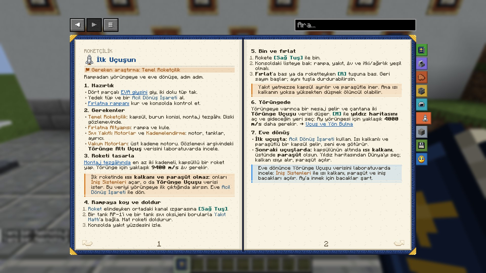

# İlk Uçuşun

*İlgili araştırma: Temel Roketçilik*

Rampadan yörüngeye ve eve dönüşe, adım adım.

### 1. Hazırlık
- Dört parçalı [EVA giysini](eva_suit) giy, iki dolu tüp tak. Kapsül basınçlıdır: koltukta otururken giysisiz de nefes alırsın, ama dışarı adım attığın an yine vakumdasın.
- Yedek tüp ve bir [Acil Dönüş İşareti](navigation) al.
- [Fırlatma rampanı](launch_pad) kur ve konsolda kontrol et.

### 2. Gerekenler
- *Temel Roketçilik*: kapsül, burun konisi, montaj tezgâhı. Diski gözlemevinde.
- *Fırlatma Altyapısı*: rampa ve kule.
- *Sıvı Yakıtlı Motorlar* ve *Kademelendirme*: motor, tanklar, ayırıcı.
- *Vakum Motorları*: üst kademe motoru. Gözlemevi arşivindeki **Yörünge Altı Uçuş** verisini laboratuvarda incele.

### 3. Roketi tasarla
[Montaj tezgâhında](rocket_assembler) en az iki kademeli, kapsüllü bir roket yap. Yörünge için yaklaşık **9400 m/s** Δv gerekir.

> [!WARNING]
> İlk roketinde **ısı kalkanı ve paraşüt olmaz**: onları *İniş Sistemleri* açar, o da **Yörünge Uçuşu** verisi ister. Bu veriyi yörüngeye ilk çıktığında alırsın. Eve [Acil Dönüş İşareti](navigation) ile dön.

### 4. Rampaya koy ve doldur
1. [Roket](rocket_assembler) elindeyken ortadaki kanal ızgarasına `Sağ Tık`.
2. Bir tank RP-1'i ve bir tank sıvı oksijeni borularla [Yakıt Hattı](launch_pad)'a bağla. Hat roketi doldurur.
3. Konsolda yakıt yüzdesini izle.

### 5. Bin ve fırlat
1. Rokete `Sağ Tık` ile bin. Kamera roketin çevresine geçer: fareyle döndür, tekerlekle yakınlaş, `F5` ile kokpite geç.
2. Konsoldaki listeye bak: rampa, yakıt, Δv ve itki/ağırlık yeşil olmalı.
3. **Fırlat**'a bas ya da roketteyken `R` tuşuna bas. Geri sayım başlar; aynı tuşla durdurabilirsin.

> [!WARNING]
> Yakıt yetmezse kapsül ayrılır ve paraşütle iner. Ama ısı kalkanın yoksa yüksekten düşmek ölümcül olabilir.

### 6. Yörüngede
Yükleme ekranı yoktur: kısa bir geçişten sonra yörüngeye varınca bir mesaj gelir ve çantana iki **Yörünge Uçuşu** verisi düşer. `M` ile **yıldız haritasını** aç, bir dünyaya tıkla ve **Yörüngeye git** ya da **Yüzeye in**'i seç. Harita yakıtın yetip yetmediğini düz dille söyler. Ay yörüngesi için yaklaşık **4000 m/s** daha gerekir. → [Uçuş ve Yön Bulma](navigation)

### 7. Eve dönüş
- **İlk uçuşta:** [Acil Dönüş İşareti](navigation) kullan. Isı kalkanlı ve paraşütlü bir kapsül gelir, seni eve götürür.
- **Sonraki uçuşlarda:** kapsülünün altında **ısı kalkanı**, üstünde **paraşüt** olsun. Yıldız haritasında Dünya'yı seçip **Yüzeye in**; kalkan ısıyı alır, paraşüt açılır.

> [!TIP]
> Eve dönünce Yörünge Uçuşu verisini laboratuvarda incele: *İniş Sistemleri* ile ısı kalkanı, paraşüt ve iniş bacakları açılır. Bunun için *Hassas İmalat* da gerekir: ısı kalkanının yapıldığı ablatif kalkan levhalarını [Parça Üretim Tezgâhı](fabricator) üretir. Ay'a inmek için bacaklar şart.

|   |   |   |
|---|---|---|
| Ablatif Kalkan Levhası | Ablatif Kalkan Levhası | Ablatif Kalkan Levhası |
| Tuğla | Obsidiyen | Tuğla |

→ **Ablatif Isı Kalkanı** (Çalışma Masası)

English: Your First Flight

*Related research: Basic Rocketry*

From the pad to orbit and back home, step by step.

### 1. Get ready
- Wear the four-piece [EVA suit](eva_suit) with two full tanks. The capsule is pressurised: seated, you breathe even without a suit, but the moment you step out you are back in vacuum.
- Take spare tanks and an [Emergency Return Beacon](navigation).
- Build your [launch pad](launch_pad) and check it at the console.

### 2. What you need
- *Basic Rocketry*: capsule, nose cone, assembler. Its disk is in the observatory.
- *Launch Infrastructure*: pad and tower.
- *Liquid-Fuel Engines* and *Staging*: engine, tanks, decoupler.
- *Vacuum Engines*: the upper-stage engine. Analyse the **Suborbital Flight** data from the observatory archive in the lab.

### 3. Design the rocket
In the [assembler](rocket_assembler), build a crewed rocket with at least two stages. Orbit needs about **9,400 m/s** of Δv.

> [!WARNING]
> Your first rocket has **no heat shield or parachute**: *Landing Systems* unlocks them, and it needs **Orbital Flight** data. You get that data the first time you reach orbit. Come home with the [Emergency Return Beacon](navigation).

### 4. Place it and fuel it
1. `Right Click` the [Rocket](rocket_assembler) on the middle trench grate.
2. Pipe a tank of RP-1 and a tank of liquid oxygen into the [Fuel Umbilical](launch_pad). It fills the rocket.
3. Watch the fuel level on the console.

### 5. Board and launch
1. Board the rocket with `Right Click`. The camera moves around the rocket: turn it with the mouse, zoom with the wheel, switch to the cockpit with `F5`.
2. Check the console's list: pad, fuel, Δv and thrust-to-weight should be green.
3. Press **Launch**, or press `R` while aboard. The countdown starts; the same key aborts it.

> [!WARNING]
> If you run out of fuel the capsule separates and comes down on its parachute. Without a heat shield, a fall from high up can still kill you.

### 6. In orbit
There is no loading screen: after a short transition, a message tells you when you arrive, and two **Orbital Flight** data drop into your bag. Open the **star map** with `M` click a world and pick **Go to orbit** or **Land**. The map tells you plainly whether your fuel is enough. Lunar orbit needs about **4,000 m/s** more. → [Flight and Navigation](navigation)

### 7. Coming home
- **First flight:** use the [Emergency Return Beacon](navigation). A capsule with a heat shield and parachute comes and takes you home.
- **Later flights:** put a **heat shield** under your capsule and a **parachute** on top. Pick Earth on the star map and **Land**; the shield takes the heat and the parachute opens.

> [!TIP]
> Back home, analyse the Orbital Flight data in the lab: *Landing Systems* unlocks the heat shield, parachute and landing legs. It also needs *Precision Manufacturing*: the fabricator makes the ablative shield plates the heat shield is built from. You need the legs to land on the Moon.

|   |   |   |
|---|---|---|
| Ablative Shield Plate | Ablative Shield Plate | Ablative Shield Plate |
| Brick | Obsidian | Brick |

→ **Ablative Heat Shield** (Crafting Table)

