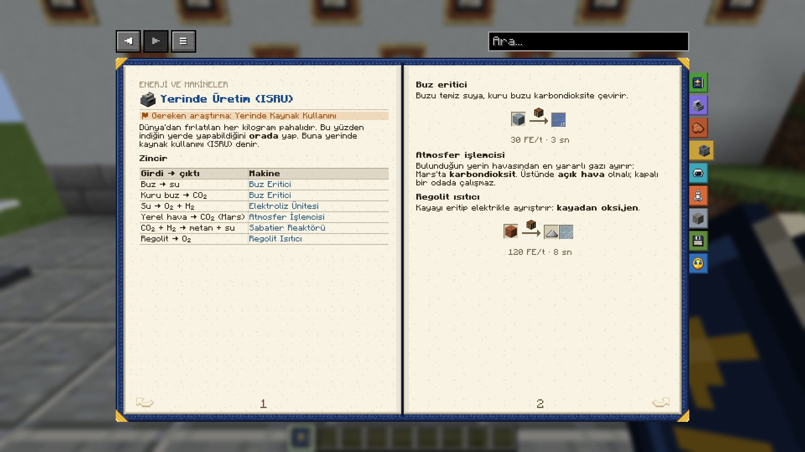

# Yerinde Üretim (ISRU)

*İlgili araştırma: Yerinde Kaynak Kullanımı*

Dünya'dan fırlatılan her kilogram pahalıdır. Bu yüzden indiğin yerde yapabildiğini **orada** yap. Buna yerinde kaynak kullanımı (ISRU) denir.

### Zincir
| Girdi → çıktı | Makine |
|---|---|
| Buz → su | **Buz Eritici** |
| Kuru buz → CO₂ | **Buz Eritici** |
| Su → O₂ + H₂ | [Elektroliz Ünitesi](first_hours) |
| Yerel hava → CO₂ (Mars) | **Atmosfer İşlemcisi** |
| CO₂ + H₂ → metan + su | **Sabatier Reaktörü** |
| Regolit → O₂ | **Regolit Isıtıcı** |

### Buz eritici
Buzu temiz suya, kuru buzu karbondioksite çevirir.

| Girdi | Makine | Çıktı |
|---|---|---|
| Ay Buzu | Çalışma Masası 30 FE/t · 3 sn | Su (1000 mB) |

### Atmosfer işlemcisi
Bulunduğun yerin havasından en yararlı gazı ayırır: Mars'ta **karbondioksit**. Üstünde **açık hava** olmalı; kapalı bir odada çalışmaz.

### Regolit ısıtıcı
Kayayı eritip elektrikle ayrıştırır: **kayadan oksijen**. Bir regolit **250 mB oksijen** verir. Güneş rüzgârı yemiş Ay ve Merkür regoliti bunun yanında **20 mB helyum-3** de verir. Hidrojeni buzdan alırsın.

| Girdi | Makine | Çıktı |
|---|---|---|
| Ay Regoliti | Çalışma Masası 120 FE/t · 8 sn | Demir Tozu (%20 şansla) Oksijen (250 mB) |

| Girdi | Makine | Çıktı |
|---|---|---|
| Merkür Regoliti | Çalışma Masası 120 FE/t · 8 sn | Oksijen (250 mB) Helyum-3 (20 mB) |

### Regolit Kazıcı

**Regolit Kazıcı**

**Regolit Kazıcı** altındaki **5×5** alanı kat kat, **16 blok** derine kadar kazar ve kazdığını yanındaki makinelere ya da sandıklara verir. **30 FE/t** harcar.

|   |   |   |
|---|---|---|
| Çelik Levha | Elektrik Motoru | Çelik Levha |
| Tungsten Çubuk | Gelişmiş Devre Kartı | Tungsten Çubuk |
| Tungsten Çubuk |   | Tungsten Çubuk |

→ **Regolit Kazıcı** (Çalışma Masası)

> [!TIP]
> **Ay üssünde tam otomatik sıvı oksijen:** kazıcı → regolit ısıtıcı → kriyojenik sıvılaştırıcı → kriyojenik tank. Hepsini borula ve kabla: sen yokken de sıvı oksijen birikir.

### Sabatier reaktörü
Karbondioksit ile hidrojeni **metan ve suya** çevirir. Su, elektroliz ünitesine geri döner. Metanı [Kriyojenik](cryogenics) sıvılaştırıcıyla **sıvı metana** çevir: sıvı oksijenle birlikte **metaloks motorlarının** yakıtıdır. Roketi yakıt hattıyla, boruyla ya da kova / kriyojenik kapla sağ tıklayarak doldur. → [Roket Parçaları](rocket_parts)

| Girdi | Makine | Çıktı |
|---|---|---|
| carbon dioxide (500 mB) hydrogen (2000 mB) | Sabatier Reaktörü 60 FE/t · 4 sn | Metan (500 mB) Su (250 mB) |

> [!TIP]
> **Mars'ta oksijen ve metan:** buz eritici → su → elektroliz ünitesi → oksijen + hidrojen; oksijen → kriyojenik sıvılaştırıcı → sıvı oksijen. Hidrojen ve atmosfer işlemcisinden gelen CO₂ Sabatier reaktörüne gider. Çıkan su yine elektroliz ünitesine gider.

### Kimyasal reaktör
Bir katı ve iki sıvıyı birleştirir; örneğin kükürt, su ve oksijenden **sülfürik asit** yapar.

| Girdi | Makine | Çıktı |
|---|---|---|
| Kükürt water (250 mB) oxygen (750 mB) | Çalışma Masası 60 FE/t · 5 sn | Sülfürik Asit (250 mB) |

### Sinterleme Fırını

**Sinterleme Fırını** · **Sinterlenmiş Regolit** · **Sinterlenmiş Regolit Tuğla**

**Sinterleme Fırını** her gezegenin regolitini elektrikle ısıtıp **Sinterlenmiş Regolit**'e kaynaştırır; hava gerekmez. Taş kesicide tuğlaya, basamağa, merdivene ve duvara çevirebilirsin.

| Girdi | Makine | Çıktı |
|---|---|---|
| Ay Regoliti | Çalışma Masası 60 FE/t · 5 sn | Sinterlenmiş Regolit |

> [!TIP]
> Üssünü yerinde üretilen tuğlayla kur: Dünya'dan blok taşıman gerekmez. **Tam bloklar sızdırmaz**; merdiven, basamak ve duvar gibi tam olmayan bloklardan hava kaçar. → [Üssün Havası](base_air)

> [!TIP]
> Asteroitlerde de üretim var: karbonlu asteroitler sudan, taşlı asteroitler metalden zengindir. → [Dünya'ya Yakın Asteroitler](near_earth_asteroids#mining)

> [!TIP]
> Kazıcıyı fırının yanına koy: kazdığı regolit doğrudan fırına girer ve yapı bloğu kendiliğinden birikir.

English: In-Situ Resources (ISRU)

*Related research: In-Situ Resources*

Every kilogram launched from Earth is expensive. So make what you can **where you land**. This is called in-situ resource utilisation (ISRU).

### The chain
| Input → output | Machine |
|---|---|
| Ice → water | **Ice Melter** |
| Dry ice → CO₂ | **Ice Melter** |
| Water → O₂ + H₂ | [Electrolyzer](first_hours) |
| Local air → CO₂ (Mars) | **Atmosphere Processor** |
| CO₂ + H₂ → methane + water | **Sabatier Reactor** |
| Regolith → O₂ | **Regolith Heater** |

### Ice melter
Turns ice into clean water and dry ice into carbon dioxide.

| Input | Machine | Output |
|---|---|---|
| Lunar Ice | Crafting Table 30 FE/t · 3 s | Water (1000 mB) |

### Atmosphere processor
Separates the most useful gas from the local air: **carbon dioxide** on Mars. It needs **open air** above it; it does not work in a closed room.

### Regolith heater
Melts rock and splits it with electricity: **oxygen from rock**. One regolith gives **250 mB of oxygen**. Moon and Mercury regolith, soaked by the solar wind, also gives **20 mB of helium-3**. Hydrogen comes from ice.

| Input | Machine | Output |
|---|---|---|
| Lunar Regolith | Crafting Table 120 FE/t · 8 s | Iron Dust (20% chance) Oxygen (250 mB) |

| Input | Machine | Output |
|---|---|---|
| Mercurian Regolith | Crafting Table 120 FE/t · 8 s | Oxygen (250 mB) Helium-3 (20 mB) |

### Regolith excavator

**Regolith Excavator**

The **Regolith Excavator** digs the **5×5** patch below it layer by layer, down to **16 blocks**, and hands what it digs to the machines or chests beside it. It uses **30 FE/t**.

|   |   |   |
|---|---|---|
| Steel Plate | Electric Motor | Steel Plate |
| Tungsten Rod | Advanced Circuit | Tungsten Rod |
| Tungsten Rod |   | Tungsten Rod |

→ **Regolith Excavator** (Crafting Table)

> [!TIP]
> **Fully automatic LOX on a Moon base:** excavator → regolith heater → cryogenic liquefier → cryogenic tank. Pipe and cable them together and liquid oxygen piles up even while you are away.

### Sabatier reactor
Turns carbon dioxide and hydrogen into **methane and water**. The water goes back to the electrolyser. Turn the methane into **liquid methane** with the [Cryogenics](cryogenics) liquefier: with liquid oxygen it fuels the **methalox engines**. Fill the rocket through the fuel umbilical, a pipe, or by right-clicking with a bucket or cryogenic canister. → [Rocket Parts](rocket_parts)

| Input | Machine | Output |
|---|---|---|
| carbon dioxide (500 mB) hydrogen (2000 mB) | Sabatier Reactor 60 FE/t · 4 s | Methane (500 mB) Water (250 mB) |

> [!TIP]
> **Oxygen and methane on Mars:** ice melter → water → electrolyser → oxygen + hydrogen; oxygen → cryogenic liquefier → liquid oxygen. Hydrogen and CO₂ from the atmosphere processor go into the Sabatier reactor. The water it gives goes back to the electrolyser.

### Chemical reactor
Combines one solid and two fluids; for example sulfur, water and oxygen make **sulfuric acid**.

| Input | Machine | Output |
|---|---|---|
| Sulfur water (250 mB) oxygen (750 mB) | Crafting Table 60 FE/t · 5 s | Sulfuric Acid (250 mB) |

### Sintering furnace

**Sintering Furnace** · **Sintered Regolith** · **Sintered Regolith Bricks**

The **Sintering Furnace** heats any planet's regolith with electricity and fuses it into **Sintered Regolith**; no air needed. A stonecutter turns it into bricks, slabs, stairs and walls.

| Input | Machine | Output |
|---|---|---|
| Lunar Regolith | Crafting Table 60 FE/t · 5 s | Sintered Regolith |

> [!TIP]
> Build your base from bricks made on site: no need to ship blocks from Earth. **Full blocks are airtight**; stairs, slabs, walls and other partial blocks leak air. → [Air for the Base](base_air)

> [!TIP]
> Asteroids can be mined too: carbonaceous ones for water, stony ones for metal. → [Near-Earth Asteroids](near_earth_asteroids#mining)

> [!TIP]
> Put the excavator next to the furnace: the regolith it digs goes straight in and building blocks pile up on their own.

