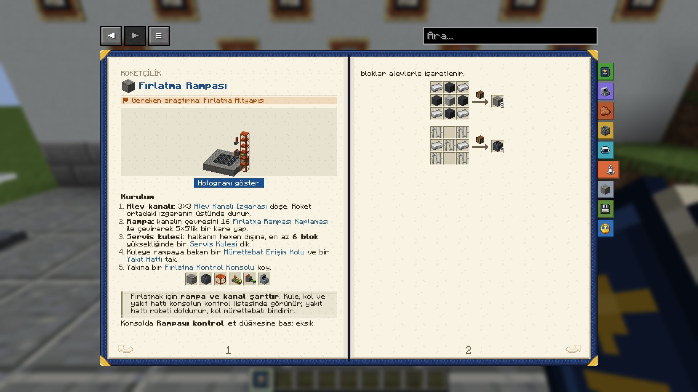

# Fırlatma Rampası

*İlgili araştırma: Fırlatma Altyapısı*

**Yapı:** Fırlatma Alanı (Hologram Projektörü ile yerleştirilebilir)

### Kurulum
1. **Alev kanalı:** 3×3 **Alev Kanalı Izgarası** döşe. Roket ortadaki ızgaranın üstünde durur.
2. **Rampa:** kanalın çevresini 16 **Fırlatma Rampası Kaplaması** ile çevirerek 5×5'lik bir kare yap.
3. **Servis kulesi:** halkanın hemen dışına, en az **6 blok** yüksekliğinde bir **Servis Kulesi** dik.
4. Kuleye rampaya bakan bir **Mürettebat Erişim Kolu** ve bir **Yakıt Hattı** tak.
5. Yakına bir **Fırlatma Kontrol Konsolu** koy.

**Fırlatma Rampası Kaplaması** · **Alev Kanalı Izgarası** · **Servis Kulesi** · **Mürettebat Erişim Kolu** · **Yakıt Hattı** · **Fırlatma Kontrol Konsolu**

> [!NOTE]
> Fırlatmak için **rampa ve kanal şarttır**. Kule, kol ve yakıt hattı konsolun kontrol listesinde görünür; yakıt hattı roketi doldurur, kol mürettebatı bindirir.

Konsolda **Rampayı kontrol et** düğmesine bas: eksik bloklar alevlerle işaretlenir.

|   |   |   |
|---|---|---|
| Demir Külçesi | Gri Beton | Demir Külçesi |
| Gri Beton | Düz Taş | Gri Beton |
| Demir Külçesi | Gri Beton | Demir Külçesi |

→ **Fırlatma Rampası Kaplaması ×8** (Çalışma Masası)

|   |   |   |
|---|---|---|
| Demir Parmaklık |   | Demir Parmaklık |
| Demir Külçesi | Demir Parmaklık | Demir Külçesi |
| Demir Parmaklık |   | Demir Parmaklık |

→ **Alev Kanalı Izgarası ×4** (Çalışma Masası)

English: Launch Pad

*Related research: Launch Infrastructure*

**Structure:** Launch Site (can be placed with the Hologram Projector)

### Building it
1. **Flame trench:** lay a 3×3 of **Flame Trench Grate**. The rocket stands on the middle grate.
2. **Pad:** ring the trench with 16 **Launch Pad Plating** to make a 5×5 square.
3. **Service tower:** just outside the ring, build a **Service Tower** at least **6 blocks** high.
4. Fit a **Crew Access Arm** and a **Fuel Umbilical** on the tower, facing the pad.
5. Place a **Launch Control Console** nearby.

**Launch Pad Plating** · **Flame Trench Grate** · **Service Tower** · **Crew Access Arm** · **Fuel Umbilical** · **Launch Control Console**

> [!NOTE]
> The **pad and trench are required** to launch. Tower, arm and umbilical show up in the console's checklist; the umbilical fuels the rocket and the arm lets the crew board.

Press **Check pad** on the console: missing blocks are marked with flames.

|   |   |   |
|---|---|---|
| Iron Ingot | Gray Concrete | Iron Ingot |
| Gray Concrete | Smooth Stone | Gray Concrete |
| Iron Ingot | Gray Concrete | Iron Ingot |

→ **Launch Pad Plating ×8** (Crafting Table)

|   |   |   |
|---|---|---|
| Iron Bars |   | Iron Bars |
| Iron Ingot | Iron Bars | Iron Ingot |
| Iron Bars |   | Iron Bars |

→ **Flame Trench Grate ×4** (Crafting Table)

