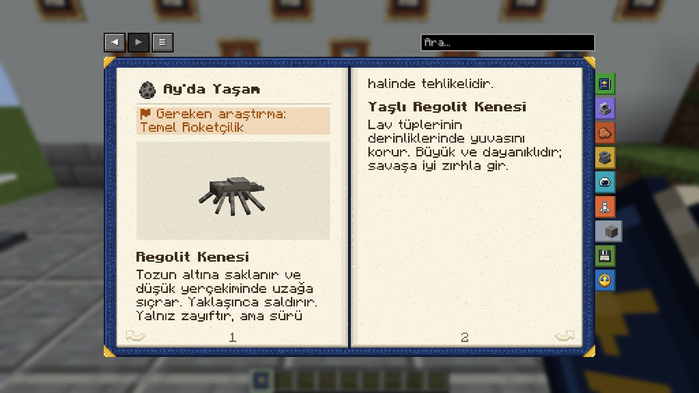

# Ay'da Yaşam

*İlgili araştırma: Temel Roketçilik*

**Canlı:** Regolit Kenesi

### Regolit Kenesi
Tozun altına saklanır ve düşük yerçekiminde uzağa sıçrar. Yaklaşınca saldırır. Yalnız zayıftır, ama sürü halinde tehlikelidir.

### Yaşlı Regolit Kenesi
Lav tüplerinin derinliklerinde yuvasını korur. Büyük ve dayanıklıdır; savaşa iyi zırhla gir.

**Canlı:** Toz Yüzücüsü

### Toz Yüzücüsü
Yüzeyin hemen altında zararsızca süzülür. Ona dokunmazsan o da sana dokunmaz.

**Canlı:** Keşif Dronu

### Keşif Dronu
Eski bir makine. Hâlâ karakolunu korur ve davetsiz misafirlere şok atışı yapar.

**Canlı:** Isı Emici

### Isı Emici
İki hafta süren Ay gecesinin buz kristalli yaratığı. Sıcaklığın peşindedir: dokunuşu seni iliklerine kadar dondurur, akülere ve jeneratörlere yapışıp depolanan enerjiyi emer ve doldukça daha parlak ışır.

> [!WARNING]
> Güneş ışığına dayanamaz, şafakta buharlaşır. Lambanın aydınlattığı yerde hiç doğmaz: güneş panellerin karardığında üssünü ve batarya odanı aydınlık tut.

English: Life on the Moon

*Related research: Basic Rocketry*

**Creature:** Regolith Tick

### Regolith Tick
Hides under the dust and leaps far in the low gravity. It attacks when you come close. Weak alone, dangerous in a swarm.

### Elder Regolith Tick
Guards its nest deep in the lava tubes. Big and tough: bring good armour.

**Creature:** Dust Swimmer

### Dust Swimmer
Glides harmlessly just under the surface. Leave it alone and it leaves you alone.

**Creature:** Survey Drone

### Survey Drone
An old machine. It still guards its outpost and fires stun bolts at intruders.

**Creature:** Heat Siphon

### Heat Siphon
A frost-crystal creature of the two-week lunar night. It hunts warmth: its touch chills you to the bone, and it latches onto batteries and generators to drink their stored charge, glowing brighter as it fills.

> [!WARNING]
> It cannot stand sunlight and sublimates at dawn. It never appears where a lamp shines: when your solar panels go dark, keep your base and battery room lit.

