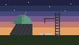

# Terk Edilmiş Gözlemevleri

Bakır kubbeli gözlemevleri açık ovalarda ve tepelerde durur. Her birinin yanında eski bir roket test rampası vardır: yıkık servis kulesini ve kararmış alev kanalını ara.

### İçeride ne var?
- Zeminin altındaki **arşiv**, ilk roketçilik teknolojilerinin disklerini saklar.
- Depoda malzeme ve yedek parça bulursun.

> [!WARNING]
> Alan boş değildir: biri **ilk kez** girdiğinde muhafızlar ortaya çıkar. Silahını ve zırhını hazırla.

> [!TIP]
> Bulduğun [Teknoloji Diski](research_basics) öğesini elindeyken kullan: teknolojiyi hemen öğrenirsin. → [Araştırmanın Temelleri](research_basics)

English: Abandoned Observatories

Copper-domed observatories stand on open plains and hills. Each has an old rocket test stand beside it: look for the broken service tower and the scorched flame trench.

### What's inside?
- The **archive** under the floor keeps disks with the first rocketry technologies.
- The stores hold materials and spare parts.

> [!WARNING]
> The site is not empty: guardians appear the **first time** anyone walks in. Bring a weapon and armour.

> [!TIP]
> Use a [Tech Disk](research_basics) you find while holding it: you learn the technology at once. → [Research Basics](research_basics)

