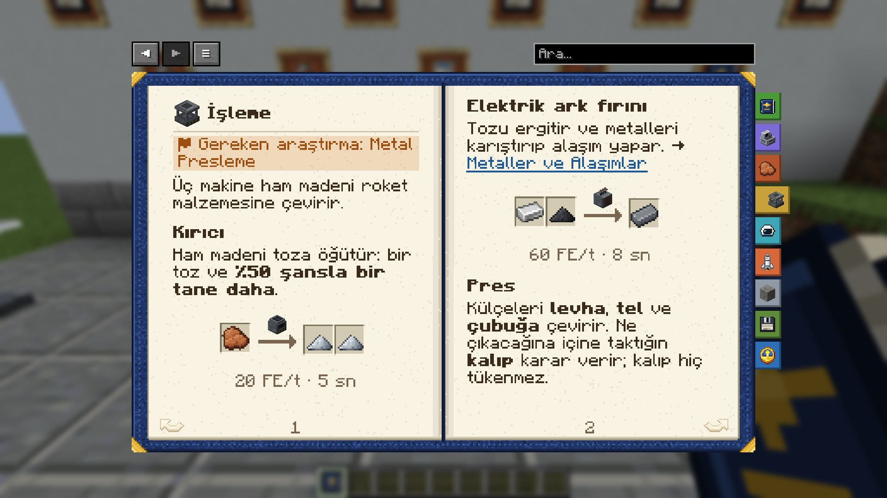

# İşleme

*İlgili araştırma: Metal Presleme*

Üç makine ham madeni roket malzemesine çevirir.

### Kırıcı
Ham madeni toza öğütür: bir toz ve **%50 şansla bir tane daha**.

| Girdi | Makine | Çıktı |
|---|---|---|
| Ham Boksit | Kırıcı 20 FE/t · 5 sn | Alüminyum Tozu Alüminyum Tozu (%50 şansla) |

### Elektrik ark fırını
Tozu ergitir ve metalleri karıştırıp alaşım yapar. → [Metaller ve Alaşımlar](metals_alloys)

| Girdi | Makine | Çıktı |
|---|---|---|
| Demir Külçesi Kömür Tozu | Elektrik Ark Fırını 60 FE/t · 8 sn | Çelik Külçe |

### Pres
Külçeleri **levha**, **tel** ve **çubuğa** çevirir. Ne çıkacağına içine taktığın **kalıp** karar verir; kalıp hiç tükenmez.

**Levha Pres Kalıbı** · **Tel Pres Kalıbı** · **Çubuk Pres Kalıbı**

| Girdi | Makine | Çıktı |
|---|---|---|
| Alüminyum Külçe | Pres 20 FE/t · 3 sn | Alüminyum Levha |

> [!TIP]
> Makinelerin hepsi enerji ister. Bir [Batarya Bankası](power) ile birkaç jeneratörü bağlarsan, enerji kesintisiz akar.

English: Processing

*Related research: Metal Pressing*

Three machines turn raw materials into rocket material.

### Crusher
Grinds raw ore into dust: one dust and a **50% chance of a second**.

| Input | Machine | Output |
|---|---|---|
| Raw Bauxite | Crusher 20 FE/t · 5 s | Aluminum Dust Aluminum Dust (50% chance) |

### Electric arc furnace
Smelts dust and melts metals together into alloys. → [Metals and Alloys](metals_alloys)

| Input | Machine | Output |
|---|---|---|
| Iron Ingot Coal Dust | Electric Arc Furnace 60 FE/t · 8 s | Steel Ingot |

### Press
Turns ingots into **plates**, **wires** and **rods**. The **die** you put in decides which; a die is never used up.

**Plate Press Die** · **Wire Press Die** · **Rod Press Die**

| Input | Machine | Output |
|---|---|---|
| Aluminum Ingot | Press 20 FE/t · 3 s | Aluminum Plate |

> [!TIP]
> Every machine needs power. Link a few generators through a [Battery Bank](power) and the power keeps flowing.

