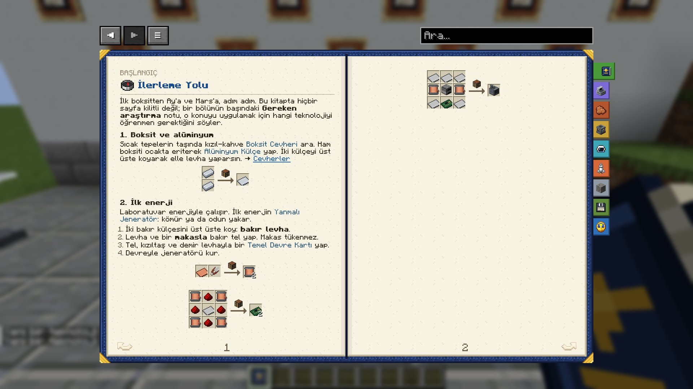

# İlerleme Yolu

İlk boksitten Ay'a ve Mars'a, adım adım. Bu kitapta hiçbir sayfa kilitli değil; bir bölümün başındaki **İlgili araştırma** notu, o konuyla ilgili teknolojiyi gösterir. Neyin gerçekten kilitlendiğini [Araştırma Nasıl İşler?](research_basics#locks) anlatır.

### 1. Boksit ve alüminyum
Kızıl-kahve [Boksit Cevheri](ores) her yerde seyrek, sıcak tepelerde bol bulunur. Ham boksiti ocakta eriterek [Alüminyum Külçe](metals_alloys) yap. İki külçeyi üst üste koyarak elle levha yaparsın. → [Cevherler](ores)

|   |
|---|
| Alüminyum Külçe |
| Alüminyum Külçe |

→ **Alüminyum Levha** (Çalışma Masası)

### 2. İlk enerji
Laboratuvar enerjiyle çalışır. İlk enerjin [Yanmalı Jeneratör](first_hours): kömür ya da odun yakar.
1. İki bakır külçesini üst üste koy: **bakır levha**.
2. Levha ve bir **makasla** bakır tel yap. Makas tükenmez.
3. Tel, kızıltaş ve demir levhayla bir [Temel Devre Kartı](components) yap.
4. Devreyle jeneratörü kur.

Bakır Levha, Makas → **Bakır Tel ×2** (Çalışma Masası, şekilsiz)

|   |   |   |
|---|---|---|
| Bakır Tel | Redstone Tozu | Bakır Tel |
| Redstone Tozu | Demir Levha | Redstone Tozu |
| Bakır Tel | Redstone Tozu | Bakır Tel |

→ **Temel Devre Kartı ×2** (Çalışma Masası)

|   |   |   |
|---|---|---|
| Demir Levha | Demir Levha | Demir Levha |
| Bakır Tel | Ocak | Bakır Tel |
| Demir Levha | Temel Devre Kartı | Demir Levha |

→ **Yanmalı Jeneratör** (Çalışma Masası)

> [!TIP]
> İlk makinen [Kırıcı](processing) için bir [Elektrik Motoru](components) gerekir. Motorun istediği demir çubuğu da elle yaparsın: üç demir külçesini dikey koy, iki çubuk çıkar.

|   |
|---|
| Demir Külçesi |
| Demir Külçesi |
| Demir Külçesi |

→ **Demir Çubuk ×2** (Çalışma Masası)

### 3. Laboratuvar ve numuneler

|   |   |   |
|---|---|---|
| Alüminyum Levha | İnce Cam | Alüminyum Levha |
| Redstone Tozu | Bakır Külçesi | Redstone Tozu |
| Alüminyum Levha | Düz Taş Basamak | Alüminyum Levha |

→ **Araştırma Laboratuvarı** (Çalışma Masası)

Jeneratörü laboratuvarın yanına koy. Bir [Numune Kiti](research_basics) yap ve doğal zemine kullan: Dünya numunesi alırsın. → [Araştırma Nasıl İşler?](research_basics)

|   |   |   |
|---|---|---|
|   | İp |   |
| Demir Külçesi | Cam Şişe | Demir Külçesi |
|   | Deri |   |

→ **Numune Kiti** (Çalışma Masası)

### 4. İlk teknolojiler
Dünya numuneleriyle şunları araştır:
- *Metal Presleme*: pres; levha ve tel çok daha ucuz olur.
- *Metalurji*: ark fırını, çelik ve alaşımlar.
- *Elektronik*, sonra *Hassas İmalat*: parça üretim tezgâhı.
- *Basınçlı Giysiler* ve *Oksijen Depolama*: EVA giysisi ve tüpler.

> [!TIP]
> Makineler, onları açan teknolojiyi bilmeyen birine aitse çalışmaz. Tarifler ise herkese açıktır. → [Araştırma neyi kilitler?](research_basics#locks)

### 5. Yakıt
- *Yakıt Rafinasyonu*: petrol pompası ve rafineri → **RP-1**. → [Petrol Rafinasyonu](oil_refining)
- *Güneş Enerjisi*, *Elektroliz* ve *Kriyojenik*: sudan oksijen, oksijenden **sıvı oksijen**. → [Kriyojenik](cryogenics)

### 6. Gözlemevi
Ovalardaki terk edilmiş gözlemevinin bodrumunda **Temel Roketçilik** diski ve **Yörünge Altı Uçuş** verisi var. Muhafızlara hazırlıklı git. → [Terk Edilmiş Gözlemevleri](observatory)

### 7. Roket
Sırayla: *Fırlatma Altyapısı*, *Sıvı Yakıtlı Motorlar*, *Kademelendirme*, *Vakum Motorları* (Yörünge Altı Uçuş verisiyle). → [İlk Uçuşun](first_flight)

### 8. Yörünge ve Ay
1. Yörüngeye çık: **Yörünge Uçuşu** verisi alırsın. Eve acil dönüş işaretiyle dön.
2. Veriyle *İniş Sistemleri*: ısı kalkanı, paraşüt, iniş bacakları.
3. Ay'a in, üs kur, harabelerdeki diskleri topla. → [Ay](moon), [Ay'daki Harabeler](moon_ruins)
4. Ay numuneleri ve diskler seni Mars'a hazırlar. → [Mars](mars)

### 9. Mars ve eve dönüş
1. *Gezegenler Arası Transfer* ile Mars'a git; yanına sızdırmaz giysi ve bol oksijen al.
2. *Sabatier Süreci* ve *Yerinde Kaynak Kullanımı*: buzdan su, sudan oksijen; havadaki CO₂'den metan.
3. Metanı ve oksijeni sıvılaştır; *Metan Motorları* ile metaloks roketini Mars'ta doldurup eve dön. → [Yerinde Üretim](isru)

English: The Road Ahead

From your first bauxite to the Moon and Mars, step by step. No page in this book is locked; a **Related research** note at the top of a chapter names the technology behind it. [How Research Works](research_basics#locks) explains what is really locked.

### 1. Bauxite and aluminium
Red-brown [Bauxite Ore](ores) is thin everywhere and rich in warm hills. Smelt raw bauxite in a furnace into [Aluminum Ingot](metals_alloys). Two ingots stacked make a plate by hand. → [Ores](ores)

|   |
|---|
| Aluminum Ingot |
| Aluminum Ingot |

→ **Aluminum Plate** (Crafting Table)

### 2. First power
The lab runs on energy. Your first power is the [Combustion Generator](first_hours): it burns coal or wood.
1. Stack two copper ingots: a **copper plate**.
2. A plate and **shears** make copper wire. The shears are not used up.
3. Wire, redstone and an iron plate make a [Basic Circuit](components).
4. Build the generator with the circuit.

Copper Plate, Shears → **Copper Wire ×2** (Crafting Table, shapeless)

|   |   |   |
|---|---|---|
| Copper Wire | Redstone Dust | Copper Wire |
| Redstone Dust | Iron Plate | Redstone Dust |
| Copper Wire | Redstone Dust | Copper Wire |

→ **Basic Circuit ×2** (Crafting Table)

|   |   |   |
|---|---|---|
| Iron Plate | Iron Plate | Iron Plate |
| Copper Wire | Furnace | Copper Wire |
| Iron Plate | Basic Circuit | Iron Plate |

→ **Combustion Generator** (Crafting Table)

> [!TIP]
> Your first machine, the [Crusher](processing), needs an [Electric Motor](components). Make the iron rods the motor needs by hand: three iron ingots in a column give two rods.

|   |
|---|
| Iron Ingot |
| Iron Ingot |
| Iron Ingot |

→ **Iron Rod ×2** (Crafting Table)

### 3. Lab and samples

|   |   |   |
|---|---|---|
| Aluminum Plate | Glass Pane | Aluminum Plate |
| Redstone Dust | Copper Ingot | Redstone Dust |
| Aluminum Plate | Smooth Stone Slab | Aluminum Plate |

→ **Research Lab** (Crafting Table)

Put the generator next to the lab. Make a [Sample Kit](research_basics) and use it on natural ground: you get an Earth sample. → [How Research Works](research_basics)

|   |   |   |
|---|---|---|
|   | String |   |
| Iron Ingot | Glass Bottle | Iron Ingot |
|   | Leather |   |

→ **Sample Kit** (Crafting Table)

### 4. First technologies
Research these with Earth samples:
- *Metal Pressing*: the press; plates and wire get much cheaper.
- *Metallurgy*: arc furnace, steel and alloys.
- *Electronics*, then *Precision Manufacturing*: the fabricator.
- *Pressure Suits* and *Oxygen Storage*: EVA suit and tanks.

> [!TIP]
> A machine does not run if its owner does not know the technology that unlocks it. Recipes are open to everyone. → [What does research lock?](research_basics#locks)

### 5. Fuel
- *Fuel Refining*: pumpjack and refinery → **RP-1**. → [Oil Refining](oil_refining)
- *Solar Power*, *Electrolysis* and *Cryogenics*: oxygen from water, **liquid oxygen** from oxygen. → [Cryogenics](cryogenics)

### 6. The observatory
The cellar of the abandoned observatory on the plains holds the **Basic Rocketry** disk and **Suborbital Flight** data. Go ready for its guardians. → [Abandoned Observatories](observatory)

### 7. The rocket
In order: *Launch Infrastructure*, *Liquid-Fuel Engines*, *Staging*, *Vacuum Engines* (with the Suborbital Flight data). → [Your First Flight](first_flight)

### 8. Orbit and the Moon
1. Reach orbit: you get **Orbital Flight** data. Come home with the emergency beacon.
2. With that data, *Landing Systems*: heat shield, parachute, landing legs.
3. Land on the Moon, build a base and collect the disks in its ruins. → [The Moon](moon), [Ruins on the Moon](moon_ruins)
4. Moon samples and disks prepare you for Mars. → [Mars](mars)

### 9. Mars and the way home
1. Go to Mars with *Interplanetary Transfers*; bring a sealed suit and plenty of oxygen.
2. *Sabatier Process* and *In-Situ Resources*: water from ice, oxygen from water, methane from the CO₂ in the air.
3. Liquefy the methane and oxygen; with *Methane Engines*, fuel your methalox rocket on Mars and fly home. → [In-Situ Resources](isru)

