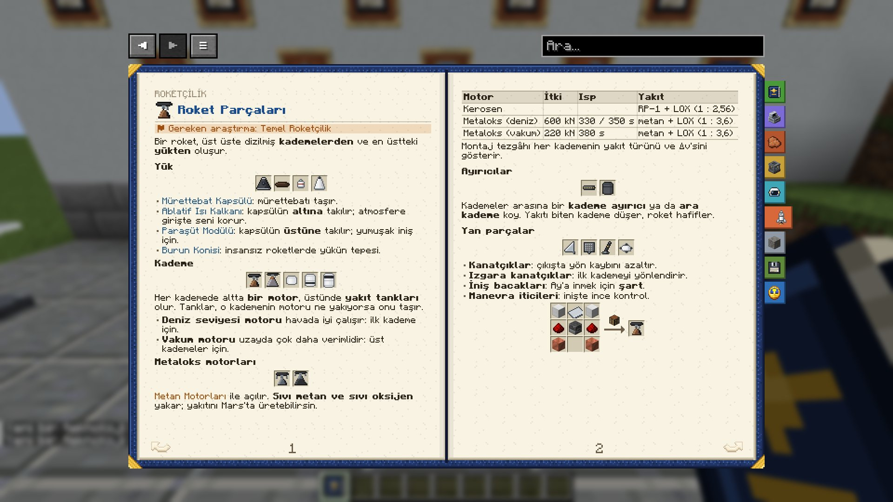

# Roket Parçaları

*İlgili araştırma: Temel Roketçilik*

Bir roket, üst üste dizilmiş **kademelerden** ve en üstteki **yükten** oluşur.

### Yük

**Mürettebat Kapsülü** · **Ablatif Isı Kalkanı** · **Paraşüt Modülü** · **Burun Konisi**

- **Mürettebat Kapsülü**: mürettebatı taşır.
- **Ablatif Isı Kalkanı**: kapsülün **altına** takılır; atmosfere girişte seni korur.
- **Paraşüt Modülü**: kapsülün **üstüne** takılır; yumuşak iniş için.
- **Burun Konisi**: insansız roketlerde yükün tepesi.

### Kademe

**Kerosen Motoru (Deniz Seviyesi)** · **Kerosen Motoru (Vakum)** · **Küçük Yakıt Tankı** · **Orta Yakıt Tankı** · **Büyük Yakıt Tankı**

Her kademede altta **bir motor**, üstünde **yakıt tankları** olur. Tanklar, o kademenin motoru ne yakıyorsa onu taşır.
- **Deniz seviyesi motoru** havada iyi çalışır: ilk kademe için.
- **Vakum motoru** uzayda çok daha verimlidir: üst kademeler için.

### Motorlar ve yakıtlar

**Metaloks Motoru (Deniz Seviyesi)** · **Metaloks Motoru (Vakum)**

**Metaloks motorları** *Metan Motorları* ile açılır. **Sıvı metan ve sıvı oksijen** yakarlar; yakıtlarını Mars'ta üretebilirsin. Isp'deki iki sayı: deniz seviyesi / vakum.

| Motor | İtki | Isp | Yakıt |
|---|---|---|---|
| Kerosen (deniz) | 560 kN | 282 / 311 s | RP-1 + LOX (1 : 2,56) |
| Kerosen (vakum) | 190 kN | 345 s | RP-1 + LOX (1 : 2,56) |
| Metaloks (deniz) | 600 kN | 330 / 350 s | metan + LOX (1 : 3,6) |
| Metaloks (vakum) | 220 kN | 380 s | metan + LOX (1 : 3,6) |

Montaj tezgâhı her kademenin yakıt türünü ve Δv'sini gösterir.

### Ayırıcılar

**Kademe Ayırıcı** · **Ara Kademe**

Kademeler arasına bir **kademe ayırıcı** ya da **ara kademe** koy. Yakıtı biten kademe düşer, roket hafifler.

### Yan parçalar

**Kanatçıklar** · **Izgara Kanatçıklar** · **İniş Bacakları** · **Manevra İticileri**

- **Kanatçıklar**: çıkışta yön kaybını azaltır.
- **Izgara kanatçıklar**: ilk kademeyi yönlendirir.
- **İniş bacakları**: Ay'a inmek için **şart**.
- **Manevra iticileri**: inişte ince kontrol.

|   |   |   |
|---|---|---|
| Demir Bloğu | Alüminyum Levha | Demir Bloğu |
| Redstone Tozu | Maden Eritme Ocağı | Redstone Tozu |
| Bakır Bloğu |   | Bakır Bloğu |

→ **Kerosen Motoru (Deniz Seviyesi)** (Çalışma Masası)

English: Rocket Parts

*Related research: Basic Rocketry*

A rocket is a stack of **stages** with the **payload** on top.

### Payload

**Crew Capsule** · **Ablative Heat Shield** · **Parachute Module** · **Nose Cone**

- **Crew Capsule**: carries the crew.
- **Ablative Heat Shield**: goes **under** the capsule; protects you during reentry.
- **Parachute Module**: goes **on top** of the capsule, for a soft landing.
- **Nose Cone**: the top of an uncrewed payload.

### Stages

**Kerosene Engine (Sea Level)** · **Kerosene Engine (Vacuum)** · **Small Fuel Tank** · **Medium Fuel Tank** · **Large Fuel Tank**

Each stage has **one engine** at the bottom and **fuel tanks** above it. The tanks carry whatever that stage's engine burns.
- The **sea-level engine** works well in air: for the first stage.
- The **vacuum engine** is far more efficient in space: for the upper stages.

### Engines and fuels

**Methalox Engine (Sea Level)** · **Methalox Engine (Vacuum)**

**Methalox engines** are unlocked by *Methane Engines*. They burn **liquid methane and liquid oxygen**; you can make that fuel on Mars. Two Isp numbers: sea level / vacuum.

| Engine | Thrust | Isp | Fuel |
|---|---|---|---|
| Kerosene (sea level) | 560 kN | 282 / 311 s | RP-1 + LOX (1 : 2.56) |
| Kerosene (vacuum) | 190 kN | 345 s | RP-1 + LOX (1 : 2.56) |
| Methalox (sea level) | 600 kN | 330 / 350 s | methane + LOX (1 : 3.6) |
| Methalox (vacuum) | 220 kN | 380 s | methane + LOX (1 : 3.6) |

The assembler shows each stage's fuel type and Δv.

### Separators

**Stage Decoupler** · **Interstage**

Put a **decoupler** or an **interstage** between stages. A stage that runs dry drops away and the rocket gets lighter.

### Side parts

**Fins** · **Grid Fins** · **Landing Legs** · **RCS Thrusters**

- **Fins**: less steering loss on ascent.
- **Grid fins**: steer the first stage.
- **Landing legs**: **required** to land on the Moon.
- **RCS thrusters**: fine control for landings.

|   |   |   |
|---|---|---|
| Block of Iron | Aluminum Plate | Block of Iron |
| Redstone Dust | Blast Furnace | Redstone Dust |
| Block of Copper |   | Block of Copper |

→ **Kerosene Engine (Sea Level)** (Crafting Table)

